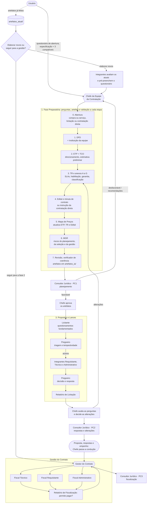
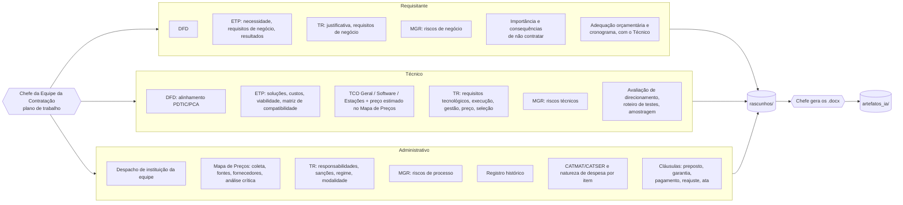
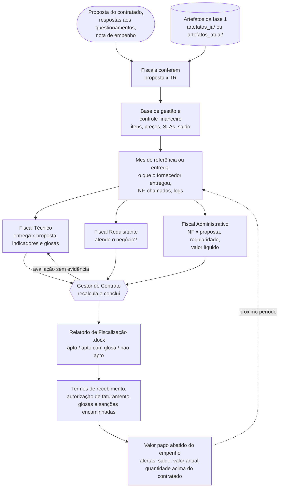
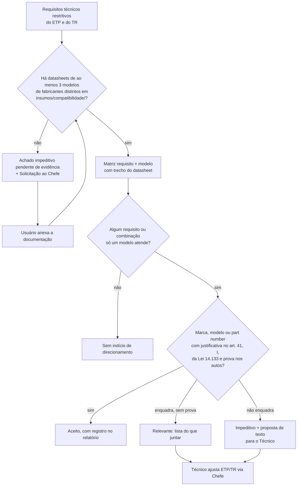

# Agentes de Planejamento da Contratação de TIC

## Sobre o projeto

Este projeto tem como base o material publicado pela Secretaria de Governo Digital (SGD) em [gov.br/governodigital/pt-br/contratacoes-de-tic](https://www.gov.br/governodigital/pt-br/contratacoes-de-tic/): legislação aplicada, IN SGD/ME nº 94/2022, modelos de contratação, orientações, templates de artefatos e listas de verificação.

O objetivo é auxiliar as Equipes de Planejamento da Contratação na elaboração de:

- Documento de Formalização da Demanda (DFD);
- Estudo Técnico Preliminar (ETP), com a análise de Custos Totais de Propriedade (TCO);
- Termo de Referência (TR) para compras ou serviços de TIC;
- Mapa de Preços;
- Mapa de Gerenciamento de Riscos (MGR).

É um grupo de agentes para Claude Code que monta e audita a fase de Planejamento da Contratação de soluções de TIC na Administração Pública Federal, conforme a Lei nº 14.133/2021 e a IN SGD/ME nº 94/2022. Os artefatos saem preenchidos sobre os templates oficiais da SGD e da AGU. Os agentes preparam os documentos; a decisão, a assinatura e a aprovação continuam com a equipe e as autoridades do órgão.

## Produtos de cada contratação

| Arquivo | Conteúdo |
|---|---|
| `01-DFD.docx` | Documento de Formalização da Demanda |
| `02-ETP.docx` | Estudo Técnico Preliminar, com a tabela-resumo do TCO |
| `03a-TCO-Geral.xlsx` | Análise dos Custos Totais de Propriedade — Geral (sempre) |
| `03b-TCO-Software.xlsx` | TCO — Software, com VPL (quando há software) |
| `03c-TCO-Estacoes-Trabalho.xlsx` | TCO — Estações de Trabalho (quando há estações) |
| `04-TR-Compras-TIC.docx` ou `04-TR-Servicos-TIC.docx` | Termo de Referência (modelos AGU) |
| `05-MGR.docx` | Mapa de Gerenciamento de Riscos |
| `08-Edital.docx` e `09-Minuta-Contrato.docx` | Edital e minuta de contrato, sobre os modelos da AGU de TIC |
| `10-Instrucao-Contratacao-Direta.docx` | só na contratação direta: hipótese legal, justificativa de preço, razão da escolha (Lei 14.133, art. 72) |
| `Anexo-D-Relatorio-Fiscalizacao.docx` | modelo do Relatório de Fiscalização usado na gestão (base: `modelos-oficiais/07-Relatorio-Fiscalizacao-template.docx`) |
| `06-Mapa-de-Precos.xlsx` | Mapa de Preços, em planilha para mostrar a memória de cálculo: coleta por parâmetro do art. 5º da IN 65/2021, análise crítica, média/mediana/menor valor, preço estimado e justificativas |
| `07-Classificacao.md` | CATMAT/CATSER e natureza de despesa SIAFI de cada item, usada no empenho e na adequação orçamentária do TR |
| `licitacao/` | pedidos simulados pelo Licitante, subsídios e minutas de resposta do Pregoeiro |
| `contrato/` | avaliações dos fiscais, Relatório de Fiscalização do Gestor, OS, termos de recebimento, medições e glosas |
| `juridico/parecer-juridico-PC<n>.docx` | minutas de parecer jurídico do Consultor Jurídico nos três pontos de controle, com a lista de verificação da AGU e a matriz de compatibilidade |

Os documentos que vão para o processo saem em **.docx** (Word); se o órgão exigir .doc, a conversão é feita com o LibreOffice. O Mapa de Preços e as planilhas de TCO ficam em .xlsx, que mostra a memória de cálculo.

## As macrofases e os agentes

A licitação segue as fases do art. 17 da Lei 14.133. Os agentes foram feitos para **novas licitações**; adesão a ata de registro de preços de outro órgão está fora do escopo. Os agentes atuam em três momentos, que são os que mais pesam na qualidade da contratação: construir o planejamento, responder a quem questiona o edital e fiscalizar o contrato. As fases de divulgação, julgamento, habilitação, recursos e homologação ficam com o agente de contratação e não têm agentes próprios.

| Macrofase | Agente | Faz |
|---|---|---|
| 1. Fase Preparatória e 3. Propostas e Lances | **Chefe da Equipe da Contratação** (sessão principal, skill `chefe-equipe-contratacao`) | abre o projeto, aplica o questionário de abertura (inclusive se já há documentos feitos em `artefatos_atual/`), decide o caminho (compra ou serviço, registro de preços, contínuo, competição, testes, amostragem, posto de trabalho), divide as atividades no plano de trabalho, aciona os integrantes, revisa, gera os .docx, aciona o Consultor Jurídico, aprova e roda Licitante e Pregoeiro |
| 1. Fase Preparatória | Integrante Requisitante (`integrante-requisitante`) | DFD, necessidade, importância da contratação e consequências de não contratar, requisitos de negócio, resultados, critérios de negócio da fiscalização |
| 1. Fase Preparatória | Integrante Técnico (`integrante-tecnico`) | avaliação de direcionamento, regra "igual ou superior, sem compensação", roteiro de testes, plano de amostragem, alinhamento ao PDTIC/PCA, análise de soluções, TCO, requisitos tecnológicos, preço estimado, critérios de julgamento, matriz de compatibilidade |
| 1. Fase Preparatória | Integrante Administrativo (`integrante-administrativo`) | instituição da equipe, conformidade com a Lei 14.133, coleta do Mapa de Preços, classificação CATMAT/CATSER e natureza de despesa SIAFI para o empenho, cláusulas de preposto, garantia, pagamento, reajuste e ata de registro de preços, modelo de proposta e comprovação trabalhista, modalidade, regime, sanções, registro histórico |
| 3. Propostas e Lances | Licitante (`licitante`, modelo Fable) | simula uma empresa interessada e só questiona o que não está claro ou está errado no TR; antes de escrever, confere se o texto já resolve e lista as dúvidas descartadas |
| 3. Propostas e Lances | Pregoeiro (`pregoeiro`) | triagem dos pedidos, aciona os integrantes para subsídio, decide, responde e consolida o Relatório de Licitação; o pregoeiro designado assina |
| Gestão do Contrato | Fiscal Técnico (`fiscal-tecnico`) | listas de verificação, indicadores, níveis de serviço, glosas, Termo de Recebimento Provisório |
| Gestão do Contrato | Fiscal Requisitante (`fiscal-requisitante`) | se a entrega resolve o negócio; necessidade, economicidade e oportunidade |
| Gestão do Contrato | Fiscal Administrativo (`fiscal-administrativo`) | prazos, empenho e pagamento conferidos contra a classificação da despesa, garantias, regularidade fiscal e trabalhista, aditivos |
| Gestão do Contrato | **Gestor do Contrato** (sessão principal, skill `gestor-contrato`) | assume a conversa com o usuário depois da assinatura; aciona os fiscais, garante o Relatório de Fiscalização de cada mês ou entrega, consolida as três avaliações, resolve divergências, emite os documentos do gestor e aciona o Consultor Jurídico no PC3 |
| Transversal | Consultor Jurídico (`consultor-juridico`, modelo Fable) | controle prévio de legalidade (Lei 14.133, art. 53) e minuta de parecer jurídico guiada pela Lista de Verificação de TIC da AGU, com teste de direcionamento e de sobrepreço, em três pontos de controle; não edita artefatos |

Chefe e Gestor são skills que a sessão principal assume, porque no Claude Code só ela aciona subagentes. Até a assinatura do contrato você fala com o Chefe; depois, com o Gestor. São 9 subagentes e 2 papéis de condução.

## Fluxo de trabalho



### Quem escreve o quê na Fase Preparatória



### Fiscalização do contrato



### Teste de direcionamento do Consultor Jurídico



## Como usar

### 1. Instalar

Descompacte a pasta e abra o Claude Code dentro dela. Os agentes (`.claude/agents/`), as skills (`.claude/skills/`) e o `CLAUDE.md` são carregados automaticamente.

```bash
cd agentes-contratacao-tic
claude
```

Para baixar normas novas a partir de links, o Claude Code precisa de uma ferramenta de raspagem web; a skill `incluir-norma` usa o Firecrawl.

### 2. Configurar o órgão (uma vez)

Preencha o bloco "Configuração do órgão" no `CLAUDE.md`: órgão, se integra o SISP, áreas de TIC e administrativa, autoridade máxima de TIC, política de riscos, PDTIC, PCA e o mínimo de modelos compatíveis do teste de direcionamento (padrão 3).

### Regras do projeto para o TR

Definidas para todas as contratações e detalhadas em `.claude/skills/chefe-equipe-contratacao/mapas/anexos-tr.md`:

- habilitação técnica sempre exigida: atestados sobre as parcelas de maior relevância (valor ≥ 4% do total), com até 50% da quantidade de cada uma (em SRP, da quantidade registrada), somatório permitido e emitente fora do grupo econômico da licitante (Lei 14.133, art. 67, §§ 1º e 2º; IN 94, art. 23);
- garantia do fabricante (ex.: computador com 5 anos de garantia) registrada em nome do órgão é condição do recebimento definitivo e do pagamento; pagamento antecipado de licença, suporte ou assinatura só com justificativa de economia ou indispensabilidade, previsão no edital e cláusula de devolução (Lei 14.133, art. 145);
- aceita-se característica igual ou superior, nunca inferior, e não se compensa requisito obrigatório não atendido com outro superior;
- o TR pede a proposta de preço e um anexo de documentação (datasheets, certidões, comprovantes) com uma matriz em que o licitante indica, para cada requisito, o arquivo e a página da comprovação;
- quando houver amostra, prova de conceito ou teste de aceitação, o TR traz roteiro de testes objetivo;
- o TR traz os níveis de serviço (indicador, fórmula, fonte, meta, faixas de glosa) e a fórmula de pagamento com teto de glosa e exemplo numérico; se o usuário não souber os SLAs, os integrantes propõem e ele valida;
- o TR prevê um Relatório de Fiscalização mensal (pagamento mensal) ou por entrega; na gestão, os agentes montam esse relatório a partir do que o fornecedor entregou e dos dados de nível de serviço e dizem se o pagamento pode ser feito;
- entrega de grande quantidade de bens é recebida por amostragem (ABNT NBR 5426);
- posto de trabalho ou dedicação exclusiva exige justificativa (IN 94, art. 5º, IX), cuidado com subordinação direta e comprovação trabalhista mensal de todos os empregados vinculados antes do pagamento (Lei 14.133, art. 121, § 3º);
- compra por registro de preços: ata de 1 ano, prorrogável por mais 1 com preço vantajoso (Lei 14.133, art. 84), com cláusula de reajuste no edital; o índice padrão é o ICTI, obrigatório nos serviços de TI (IN 94, art. 24).

### 3. Iniciar uma contratação

```
/chefe-equipe-contratacao nova contratação: notebooks-2027
```

O objetivo da fase 1 é sempre produzir os artefatos da contratação: DFD, ETP, TR com anexos, Mapa de Preços e Mapa de Riscos, gravados em `projetos/<projeto>/artefatos_ia/`.

O Chefe da Equipe da Contratação cria `projetos/notebooks-2027/` e começa pela pergunta: **esta contratação já tem algum artefato feito?** Se tiver, coloque os arquivos em `projetos/notebooks-2027/artefatos_atual/` (ver passo 5). Depois aplica o questionário de abertura (`.claude/skills/chefe-equipe-contratacao/insumos/questionario-abertura.md`): compra ou serviço, registro de preços, contínuo ou por escopo, especificação com 3 equipamentos compatíveis ou justificativa de marca/fornecedor exclusivo, testes, amostragem e posto de trabalho. Depois pede os insumos. Os modelos estão em `.claude/skills/chefe-equipe-contratacao/insumos/`:

- `diretrizes.md`: órgão, PCA, PDTIC, forma pretendida, prazos, orçamento
- `projeto.md`: problema, objetivos, escopo, quantidades com memória de cálculo
- `especificacoes-tecnicas.md`: requisitos, segurança, níveis de serviço, modelos compatíveis, marca/part number e hipótese legal

Você pode colar o conteúdo no chat ou anexar .docx/.pdf; o Chefe converte e salva em `insumos/`. Datasheets de equipamentos compatíveis vão em `insumos/compatibilidade/`.

### 4. Acompanhar

O Chefe roda as etapas da figura uma de cada vez: faz as perguntas da etapa, gera o artefato, mostra a você e só segue depois da sua validação. Ele mostra a cada etapa só as pendências `[PREENCHER]` que dependem de você e registra tudo em `registro-historico.md`. Comandos úteis:

| Você diz | O que acontece |
|---|---|
| "chefe, continue o notebooks-2027" | retoma da última etapa registrada |
| "refaça o ETP com 150 unidades" | o Chefe devolve ao Requisitante e ao Técnico e regenera o que depende do ETP |
| "gere os produtos" | gera os .docx em `artefatos_ia/` (e as planilhas de memória de cálculo) |
| "classifique os itens" | o Integrante Administrativo indica CATMAT/CATSER e natureza de despesa para o empenho; Requisitante e Técnico escrevem a adequação orçamentária e o cronograma (IN 94, art. 21) |
| "chame o consultor jurídico" | ponto de controle 1: minuta de parecer jurídico e lista de verificação da AGU em `juridico/` |
| "anexei os datasheets, refaça o teste de direcionamento" | o Consultor Jurídico refaz só o teste de direcionamento |
| "rode o licitante no edital do notebooks-2027" | o Licitante questiona só o que o TR não deixa claro; o Pregoeiro aciona os integrantes, responde e entrega o Relatório de Licitação; o Chefe avalia as perguntas, decide as alterações e os integrantes corrigem o TR |
| "chegou uma impugnação ao edital" (anexe o pedido e o edital) | o Pregoeiro faz a triagem, os integrantes dão subsídio, o Pregoeiro redige a decisão e a resposta |
| "segue a proposta vencedora" (anexe a proposta, as respostas aos questionamentos e o empenho; contrato e designações, se já houver) | o Chefe passa a condução ao Gestor do Contrato (`/gestor-contrato`); os fiscais conferem a proposta contra o TR, o Gestor monta a base de gestão e prepara pauta, ata e checklist de termos |
| "seguem as entregas de setembro" (anexe NF, relatório da contratada, chamados, logs) | setembro vira o mês de referência; o Gestor confere se veio tudo, os três fiscais analisam, o Gestor recalcula indicadores e glosas e gera o Relatório de Fiscalização de setembro, dizendo se o pagamento pode ser feito e por quanto |
| "pago: R$ 48.200,00 em 10/10" | o Gestor lança o pagamento, abate do empenho e avisa se o saldo, o valor anual ou a quantidade contratada estiverem perto do limite |
| "avalie a OS 3" ou "apure setembro" | os três fiscais avaliam em paralelo; o Gestor consolida, resolve divergências e emite o recebimento definitivo e as glosas |
| "prepare a prorrogação" | o Gestor segue `rotinas/prorrogacao.md`: necessidade, pesquisa de preços dos fiscais, desempenho, negociação, MGR e parecer do Consultor Jurídico |
| "calcule o reajuste" (anexe a série do ICTI) | o Gestor segue `rotinas/reajuste-icti.md` e gera a planilha e a minuta de apostila |
| "verifique a coerência" | roda `verificar_coerencia.py`: valores, quantidades e códigos do Mapa de Preços contra ETP, TR e Edital, e pendências esquecidas |
| "peça parecer sobre a fiscalização" | ponto de controle 3 do Consultor Jurídico |

### 5. Partir de artefatos já feitos (`artefatos_atual/`)

Se a equipe já escreveu parte do processo, coloque os arquivos (.docx, .doc, .odt, .pdf, .xlsx) em `projetos/<projeto>/artefatos_atual/` e diga:

```
/chefe-equipe-contratacao já tenho documentos em artefatos_atual do processo X
```

O Chefe converte os arquivos, monta `artefatos_atual/inventario.md`, diz quais dos cinco artefatos estão lá e pergunta:

- **elaborar novos artefatos**: os integrantes avaliam os atuais, respondem às perguntas deixadas pelo autor (`pareceres/parecer-artefatos-atual.md`), o questionário é pré-preenchido com o que os artefatos já dizem (você confirma) e a fase 1 roda com eles como base; o resultado vai para `artefatos_ia/`;
- **seguir para a fase 2**: o Gestor do Contrato assume usando os artefatos atuais. Se faltar algum artefato, ou o TR não tiver como medir e pagar, o Chefe avisa antes.

`artefatos_atual/` nunca é sobrescrita.

### 6. Contratação direta

Se a Etapa 0 indicar fornecedor exclusivo (inexigibilidade, art. 74, I) ou dispensa (art. 75), o Chefe segue `mapas/contratacao-direta.md`. As etapas são as mesmas, mas na Etapa 4 o Edital dá lugar à instrução da contratação direta, com os documentos do art. 72: documento de exclusividade ou somatório do exercício, justificativa de preço (inclusive por notas fiscais de outros contratantes, art. 23, § 4º), razão da escolha, habilitação, minuta de autorização e de extrato. Não há Licitante nem Pregoeiro. O Consultor Jurídico usa a lista específica de inexigibilidade ou de dispensa da AGU. Marca vendida por várias revendas continua sendo licitação.

### 6.1. Quadrante Mágico do Gartner e relatórios de analistas

É comum citar o Quadrante Mágico do Gartner (ou Forrester Wave, IDC MarketScape) em contratações de TIC. Nos agentes, ele entra só no levantamento de mercado do ETP (IN 94, art. 11, II), com nome, edição, data e forma de acesso. Não pode virar requisito, critério de habilitação, de pontuação ou de aceitação: é relatório privado, pago, que muda a cada edição e usa critérios do analista, e a exigência restringe a competição (Lei 14.133, art. 9º, I, "a"; IN 94, art. 13). O que o relatório aponta de relevante vira requisito técnico objetivo e passa pelo teste dos 3 modelos compatíveis. O Licitante questiona e o Consultor Jurídico aponta como impeditivo o uso do quadrante como exigência. Não achei acórdão do TCU específico sobre o Gartner na base; a regra decorre das normas citadas.

### 7. Incluir normas ou modelos novos

Cole o link no chat. A skill `incluir-norma` baixa o texto, coloca o cabeçalho (título, origem, data, situação) e atualiza `base-legal/INDICE.md`. O que ainda falta baixar está em `base-legal/PENDENCIAS-DOWNLOAD.md`.

### 8. Atualizar um template oficial

Substitua o arquivo em `modelos-oficiais/` mantendo o nome e peça ao Chefe para extrair de novo. O texto extraído fica em `base-legal/modelos-orientacoes/templates-artefatos-sgd/extraido/`.

## Base legal

Textos integrais em `base-legal/normas/` (lista completa em `base-legal/INDICE.md`).

| Norma | Assunto | Situação |
|---|---|---|
| Lei 14.133/2021 | Licitações e contratos | vigente |
| Lei 12.462/2011 | RDC | arts. 1º a 47-A revogados |
| Lei 14.744/2023 | Serviços postais e de comunicação multimídia | vigente |
| Decreto 12.124/2024 | Regulamenta a Lei 14.744 | vigente |
| Decreto 11.462/2023 | Registro de preços | vigente |
| Decreto 11.246/2022 | Agente de contratação, gestores e fiscais | vigente, alterado |
| Decreto 10.947/2022 | Plano de Contratações Anual | vigente, alterado |
| Decreto 10.193/2019 | Limites e instâncias de governança | vigente, alterado |
| Decreto 10.024/2019 | Pregão eletrônico (Lei 10.520) | só referência |
| Decreto 9.488/2018 | Altera Decretos 7.892 e 7.579 | parcialmente revogado |
| Decreto 7.174/2010 | Bens e serviços de informática | vigente |
| IN SGD/ME 94/2022 | Processo de contratação de TIC | vigente |
| IN SGD/MGI 6/2023 | Aprovação prévia (alçadas) | compilada com a IN 86/2025 |
| IN SGD/MGI 86/2025 | Altera a IN 6/2023 | vigente |
| IN SEGES/ME 58/2022 | ETP | vigente |
| IN SEGES/ME 81/2022 | TR | vigente |
| IN SEGES/ME 65/2021 | Pesquisa de preços | vigente |
| IN SEGES/ME 67/2021 | Dispensa eletrônica | vigente, alterada |
| IN SEGES/ME 73/2022 | Menor preço ou maior desconto | vigente, alterada |
| IN SEGES/ME 73/2020 | Pesquisa de preços, leis antigas | só regime anterior |
| IN SEGES/MP 5/2017 | Serviços, com anexos | vigente, alterada |
| IN SEGES/MP 3/2018 | SICAF | vigente, alterada |
| IN SLTI 1/2010 | Sustentabilidade | vigente |
| Portaria SGD/MGI 5.950/2023 | Modelo de software e nuvem | vigente |
| Portaria SGD/MGI 750/2023 (+ 6.679/2024, 6.040/2025, 4.777/2026) | Modelo de desenvolvimento de software | consolidada |
| Portaria SGD/MGI 1.070/2023 (+ 6.680/2024, 6.055/2025, 5.921/2026) | Modelo de operação de infraestrutura | consolidada |
| Portaria SGD/MGI 2.715/2023 | Modelo de estações de trabalho | vigente |
| Portaria SGD/MGI 370/2023 | Modelo de outsourcing de impressão | vigente |
| Portaria SGD/MGI 3.656/2026 | Roteiro de Métricas de Software do SISP | vigente |

### Manuais de referência

| Documento | Uso |
|---|---|
| **Licitações & Contratos: Orientações e Jurisprudência do TCU**, 5ª ed., 2025 (`base-legal/manuais/tcu-licitacoes-contratos-5ed-2025.md`) | manual oficial do TCU, já pela Lei 14.133. Índice das 204 seções com a linha no arquivo; três análises (planejamento, seleção do fornecedor, gestão e governança) com cerca de 240 acórdãos úteis e 90 instruções incorporadas nos agentes. Os agentes podem citar os acórdãos que o manual traz |
| Governança em TIC para o Setor Público, coletânea de trabalhos do curso de especialização UnB/TCU (`base-legal/manuais/`) | referência doutrinária. A análise `tcu-governanca-tic-analise.md` lista os 29 trabalhos, os pontos desatualizados frente à Lei 14.133 e à IN 94 e as 25 recomendações incorporadas nos agentes. Não é norma nem entendimento oficial do TCU |
| Manual de Classificação da Despesa Pública, 2ª ed., Controladoria-Geral do Estado de Pernambuco (2021) | base do guia de classificação usado pelo Integrante Administrativo e pelo Fiscal Administrativo (skill `classificacao-despesa`). Categoria, grupo, modalidade e elemento são nacionais; subelementos são do Estado e precisam de confirmação com o orçamento do órgão |

### Normas retiradas da base

Normas revogadas foram retiradas em 23/10/2026 para que os agentes não as citem por engano:

- IN SGD/ME nº 1/2019 (contratação de TIC sob a Lei 8.666), revogada pela IN SGD/ME nº 94/2022;
- Diretrizes Gerais para Contratações de TIC da SGD, vinculadas à IN 1/2019.

Também não foram incluídas as demais normas que o portal do Governo Digital lista como revogadas: Lei 8.666/1993, Lei 10.520/2002, Decreto 7.892/2013, IN SGD/ME 5/2021, Portarias SGD/ME 6.432/2021, 844/2022 e 5.651/2022, Portarias STI/MP 4/2017 e 20/2016, IN SEGES/MP 1/2019, Portaria 6.432/2018, IN SEGES/MP 5/2014, INs SGD/ME 2/2019 e 90/2020, INs SLTI/MP 4/2014, 4/2010 e 4/2008 e as diretrizes antigas de fábrica de software, outsourcing de impressão e suporte e atendimento.

Ficaram na base, por terem dispositivos ainda vigentes ou uso residual: Lei 12.462/2011 (arts. 1º a 47-A revogados), Decreto 9.488/2018 (art. 1º revogado), Decreto 10.024/2019 (regulamenta a Lei 10.520) e IN SEGES/ME 73/2020 (só para processos das leis antigas). O cabeçalho de cada uma indica o que vale.

Faltando: os anexos e planilhas listados em `base-legal/PENDENCIAS-DOWNLOAD.md`.

## Regras que todos os agentes seguem

- Toda citação legal indica norma, dispositivo e arquivo da base, conferida no texto com `buscar_artigo.py`. Norma fora da base não é citada de memória.
- Dado que não veio dos insumos ou de você fica `[PREENCHER]`. Preço, quantidade, nome e número de processo não são inventados.
- Quando o objeto é compatível com um modelo de contratação da SGD (nuvem e software, estações de trabalho, desenvolvimento de software, impressão, operação de infraestrutura, empresas públicas, comunicação de dados, UST, métricas), o modelo é aplicado no ETP e no TR. Tabela de gatilhos: `.claude/skills/chefe-equipe-contratacao/mapas/modelos-sgd.md`.
- Cada agente escreve só a sua parte (IN 94, art. 10, § 3º; na gestão, art. 29, §§ 3º e 4º).
- O Consultor Jurídico trabalha com o que está nos autos e não lê os pareceres internos antes de concluir.
- O Licitante só lê documentos públicos do processo (edital, TR, ETP e anexos publicados).
- Os agentes preparam os documentos; a assinatura, a aprovação e o parecer jurídico (Lei 14.133, art. 53) continuam com as pessoas e unidades competentes.

## Estrutura

```
CLAUDE.md                     regras e configuração do órgão
README.md                     este arquivo
.claude/agents/               integrantes, licitante, pregoeiro, fiscais, consultor jurídico (9 subagentes)
.claude/skills/
  chefe-equipe-contratacao/   condução até a assinatura: macrofases, insumos, mapas, checklist, scripts (despejar_xlsx.py, gerar_mapa_precos.py)
  gestor-contrato/            condução na Gestão do Contrato; rotinas/ (prorrogação, reajuste ICTI, sanção, encerramento); scripts/ (modelo do Relatório de Fiscalização)
  classificacao-despesa/      guia de natureza de despesa para TIC
  base-legal-tic/             consulta às normas, buscar_artigo.py, gerar_indice.py
  incluir-norma/              download de normas novas
modelos-oficiais/             8 templates oficiais (.docx/.xlsx) + Mapa de Preços e Relatório de Fiscalização (modelos próprios)
base-legal/                   normas, modelos, manuais, INDICE.md, PENDENCIAS-DOWNLOAD.md
projetos/<projeto>/           artefatos_atual, insumos, rascunhos, artefatos_ia, pareceres, juridico, licitacao, contrato
```
