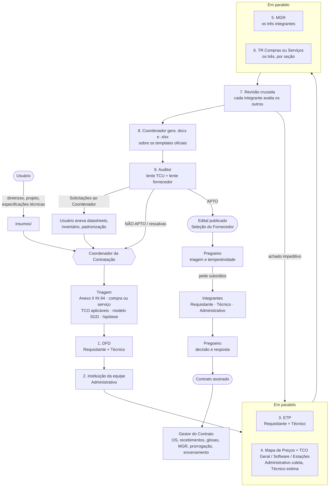
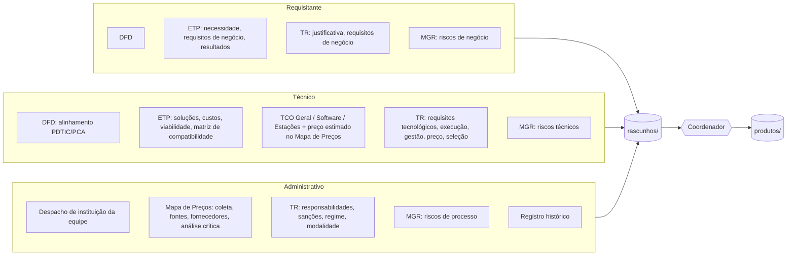
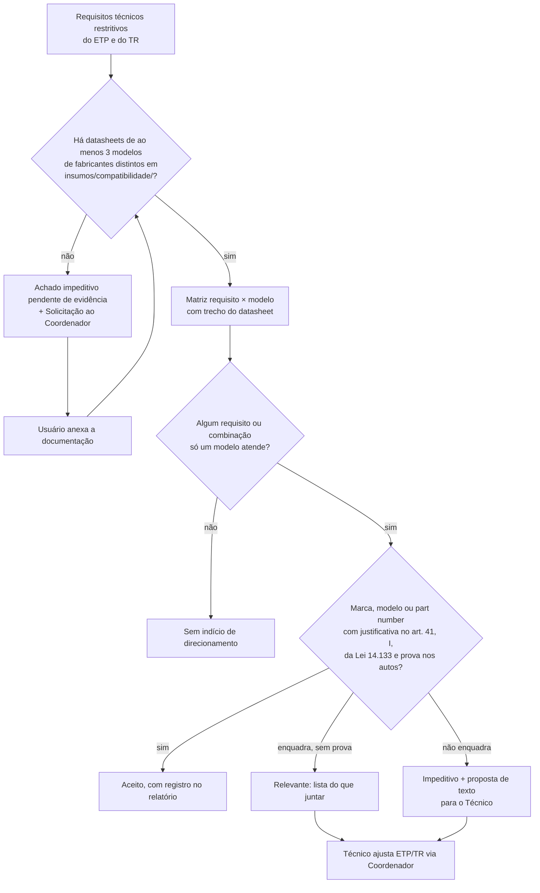

# Agentes de Planejamento da Contratação de TIC

## Sobre o projeto

Este projeto tem como base o material publicado pela Secretaria de Governo Digital (SGD) em [gov.br/governodigital/pt-br/contratacoes-de-tic](https://www.gov.br/governodigital/pt-br/contratacoes-de-tic/): legislação aplicada, IN SGD/ME nº 94/2022, modelos de contratação, orientações, templates de artefatos e listas de verificação.

O objetivo é auxiliar as Equipes de Planejamento da Contratação na elaboração de:

- Documento de Formalização da Demanda (DFD);
- Estudo Técnico Preliminar (ETP), com a análise de Custos Totais de Propriedade (TCO);
- Termo de Referência (TR) para compras ou serviços de TIC;
- Mapa de Preços;
- Mapa de Gerenciamento de Riscos (MGR).

É um grupo de agentes para Claude Code que monta e audita a fase de Planejamento da Contratação de soluções de TIC na Administração Pública Federal, conforme a Lei nº 14.133/2021 e a IN SGD/ME nº 94/2022. Os artefatos saem preenchidos sobre os templates oficiais da SGD e da AGU. Os agentes preparam os documentos; a decisão, a assinatura e a aprovação continuam com a equipe e as autoridades do órgão.

## Produtos de cada contratação

| Arquivo | Conteúdo |
|---|---|
| `01-DFD.docx` | Documento de Formalização da Demanda |
| `02-ETP.docx` | Estudo Técnico Preliminar, com a tabela-resumo do TCO |
| `03a-TCO-Geral.xlsx` | Análise dos Custos Totais de Propriedade — Geral (sempre) |
| `03b-TCO-Software.xlsx` | TCO — Software, com VPL (quando há software) |
| `03c-TCO-Estacoes-Trabalho.xlsx` | TCO — Estações de Trabalho (quando há estações) |
| `04-TR-Compras-TIC.docx` ou `04-TR-Servicos-TIC.docx` | Termo de Referência (modelos AGU) |
| `05-MGR.docx` | Mapa de Gerenciamento de Riscos |
| `06-Mapa-de-Precos.xlsx` | Mapa de Preços: coleta por parâmetro do art. 5º da IN 65/2021, análise crítica, média/mediana/menor valor, preço estimado e justificativas (modelo próprio, a detalhar) |
| `auditoria/relatorio-auditoria.md` | Relatório do auditor, com a matriz de compatibilidade |

## Os agentes

| Agente | Tipo | Faz |
|---|---|---|
| Coordenador da Contratação | sessão principal (skill `coordenador-contratacao`) | abre o projeto, cobra os insumos, faz a triagem, distribui as tarefas, consolida, gera os .docx/.xlsx e chama o auditor |
| Integrante Requisitante | subagente `integrante-requisitante` | DFD, necessidade, requisitos de negócio, justificativa, resultados, cronograma e orçamento (com o Técnico) |
| Integrante Técnico | subagente `integrante-tecnico` | alinhamento ao PDTIC/PCA, análise de soluções, TCO, requisitos tecnológicos, estimativa de preço, critérios de julgamento, matriz de compatibilidade |
| Integrante Administrativo | subagente `integrante-administrativo` | instituição da equipe, conformidade com a Lei 14.133, apoio à pesquisa de preços, modalidade, regime, sanções, riscos de processo, registro histórico |
| Auditor | subagente `auditor-contratacao` | fiscaliza o pacote final com duas lentes: auditor do TCU (legalidade, economicidade, sobrepreço, direcionamento) e fornecedor concorrente (motivos de impugnação); não edita artefatos |
| Pregoeiro | subagente `pregoeiro` | na fase de Seleção do Fornecedor, faz a triagem de esclarecimentos, impugnações e recursos, pede subsídios aos integrantes da equipe e redige a minuta de decisão e de resposta; o pregoeiro designado assina |
| Gestor do Contrato | subagente `gestor-contrato` | na fase de Gestão do Contrato, prepara OS, termos de recebimento, glosas, sanções, histórico de gestão, MGR anual, prorrogação e encerramento; gestor e fiscais assinam |

O Coordenador é a sessão principal porque, no Claude Code, só ela aciona subagentes.

## Fluxo de trabalho



### Quem escreve o quê



### Teste de direcionamento do auditor



## Como usar

### 1. Instalar

Descompacte a pasta e abra o Claude Code dentro dela. Os agentes (`.claude/agents/`), as skills (`.claude/skills/`) e o `CLAUDE.md` são carregados automaticamente.

```bash
cd agentes-contratacao-tic
claude
```

Para baixar normas novas a partir de links, o Claude Code precisa de uma ferramenta de raspagem web; a skill `incluir-norma` usa o Firecrawl.

### 2. Configurar o órgão (uma vez)

Preencha o bloco "Configuração do órgão" no `CLAUDE.md`: órgão, se integra o SISP, áreas de TIC e administrativa, autoridade máxima de TIC, política de riscos, PDTIC, PCA e o mínimo de modelos compatíveis do teste de direcionamento (padrão 3).

### 3. Iniciar uma contratação

```
/coordenador-contratacao nova contratação: notebooks-2027
```

O Coordenador cria `projetos/notebooks-2027/` e pede os três insumos. Os modelos estão em `.claude/skills/coordenador-contratacao/insumos/`:

- `diretrizes.md`: órgão, PCA, PDTIC, forma pretendida, prazos, orçamento
- `projeto.md`: problema, objetivos, escopo, quantidades com memória de cálculo
- `especificacoes-tecnicas.md`: requisitos, segurança, níveis de serviço, modelos compatíveis, marca/part number e hipótese legal

Você pode colar o conteúdo no chat ou anexar .docx/.pdf; o Coordenador converte e salva em `insumos/`. Datasheets de equipamentos compatíveis vão em `insumos/compatibilidade/`.

### 4. Acompanhar

O Coordenador roda as etapas da figura, mostra a cada etapa só as pendências `[PREENCHER]` que dependem de você e registra tudo em `registro-historico.md`. Comandos úteis:

| Você diz | O que acontece |
|---|---|
| "coordenador, continue o notebooks-2027" | retoma da última etapa registrada |
| "refaça o ETP com 150 unidades" | o Coordenador devolve ao Requisitante e ao Técnico e regenera o que depende do ETP |
| "gere os produtos" | etapa 8: .docx e .xlsx em `produtos/` |
| "chame o auditor" | etapa 9: relatório em `auditoria/` |
| "anexei os datasheets, reaudite o direcionamento" | o auditor refaz só o teste de direcionamento |
| "chegou uma impugnação ao edital do notebooks-2027" (anexe o pedido e o edital) | pregoeiro faz a triagem, os integrantes dão subsídio, o pregoeiro redige a decisão e a resposta |
| "contrato assinado, prepare a reunião inicial" (anexe contrato e designações) | gestor-contrato prepara pauta, ata e checklist de termos |
| "apure os níveis de serviço de setembro" | gestor-contrato calcula indicadores e glosas pelo TR |
| "prepare a prorrogação" | gestor-contrato monta a documentação do art. 36 da IN 94, com novo Mapa de Preços |

### 5. Só avaliar artefatos prontos

```
/coordenador-contratacao avaliar: anexei DFD, ETP e TR do processo X
```

O Coordenador pula a construção, roda a revisão cruzada dos três integrantes e depois o auditor. Saída: `pareceres/parecer-consolidado.md` e `auditoria/relatorio-auditoria.md`.

### 6. Incluir normas ou modelos novos

Cole o link no chat. A skill `incluir-norma` baixa o texto, coloca o cabeçalho (título, origem, data, situação) e atualiza `base-legal/INDICE.md`. O que ainda falta baixar está em `base-legal/PENDENCIAS-DOWNLOAD.md`.

### 7. Atualizar um template oficial

Substitua o arquivo em `modelos-oficiais/` mantendo o nome e peça ao Coordenador para extrair de novo. O texto extraído fica em `base-legal/modelos-orientacoes/templates-artefatos-sgd/extraido/`.

## Base legal

Textos integrais em `base-legal/normas/` (lista completa em `base-legal/INDICE.md`).

| Norma | Assunto | Situação |
|---|---|---|
| Lei 14.133/2021 | Licitações e contratos | vigente |
| Lei 12.462/2011 | RDC | arts. 1º a 47-A revogados |
| Lei 14.744/2023 | Serviços postais e de comunicação multimídia | vigente |
| Decreto 12.124/2024 | Regulamenta a Lei 14.744 | vigente |
| Decreto 11.462/2023 | Registro de preços | vigente |
| Decreto 11.246/2022 | Agente de contratação, gestores e fiscais | vigente, alterado |
| Decreto 10.947/2022 | Plano de Contratações Anual | vigente, alterado |
| Decreto 10.193/2019 | Limites e instâncias de governança | vigente, alterado |
| Decreto 10.024/2019 | Pregão eletrônico (Lei 10.520) | só referência |
| Decreto 9.488/2018 | Altera Decretos 7.892 e 7.579 | parcialmente revogado |
| Decreto 7.174/2010 | Bens e serviços de informática | vigente |
| IN SGD/ME 94/2022 | Processo de contratação de TIC | vigente |
| IN SGD/MGI 6/2023 | Aprovação prévia (alçadas) | compilada com a IN 86/2025 |
| IN SGD/MGI 86/2025 | Altera a IN 6/2023 | vigente |
| IN SEGES/ME 58/2022 | ETP | vigente |
| IN SEGES/ME 81/2022 | TR | vigente |
| IN SEGES/ME 65/2021 | Pesquisa de preços | vigente |
| IN SEGES/ME 67/2021 | Dispensa eletrônica | vigente, alterada |
| IN SEGES/ME 73/2022 | Menor preço ou maior desconto | vigente, alterada |
| IN SEGES/ME 73/2020 | Pesquisa de preços, leis antigas | só regime anterior |
| IN SEGES/MP 5/2017 | Serviços, com anexos | vigente, alterada |
| IN SEGES/MP 3/2018 | SICAF | vigente, alterada |
| IN SLTI 1/2010 | Sustentabilidade | vigente |
| Portaria SGD/MGI 5.950/2023 | Modelo de software e nuvem | vigente |
| Portaria SGD/MGI 750/2023 (+ 6.679/2024, 6.040/2025, 4.777/2026) | Modelo de desenvolvimento de software | consolidada |
| Portaria SGD/MGI 1.070/2023 (+ 6.680/2024, 6.055/2025, 5.921/2026) | Modelo de operação de infraestrutura | consolidada |
| Portaria SGD/MGI 2.715/2023 | Modelo de estações de trabalho | vigente |
| Portaria SGD/MGI 370/2023 | Modelo de outsourcing de impressão | vigente |
| Portaria SGD/MGI 3.656/2026 | Roteiro de Métricas de Software do SISP | vigente |

### Normas retiradas da base

Normas revogadas foram retiradas em 23/10/2026 para que os agentes não as citem por engano:

- IN SGD/ME nº 1/2019 (contratação de TIC sob a Lei 8.666), revogada pela IN SGD/ME nº 94/2022;
- Diretrizes Gerais para Contratações de TIC da SGD, vinculadas à IN 1/2019.

Também não foram incluídas as demais normas que o portal do Governo Digital lista como revogadas: Lei 8.666/1993, Lei 10.520/2002, Decreto 7.892/2013, IN SGD/ME 5/2021, Portarias SGD/ME 6.432/2021, 844/2022 e 5.651/2022, Portarias STI/MP 4/2017 e 20/2016, IN SEGES/MP 1/2019, Portaria 6.432/2018, IN SEGES/MP 5/2014, INs SGD/ME 2/2019 e 90/2020, INs SLTI/MP 4/2014, 4/2010 e 4/2008 e as diretrizes antigas de fábrica de software, outsourcing de impressão e suporte e atendimento.

Ficaram na base, por terem dispositivos ainda vigentes ou uso residual: Lei 12.462/2011 (arts. 1º a 47-A revogados), Decreto 9.488/2018 (art. 1º revogado), Decreto 10.024/2019 (regulamenta a Lei 10.520) e IN SEGES/ME 73/2020 (só para processos das leis antigas). O cabeçalho de cada uma indica o que vale.

Faltando: os anexos e planilhas listados em `base-legal/PENDENCIAS-DOWNLOAD.md`.

## Regras que todos os agentes seguem

- Toda citação legal indica norma, dispositivo e arquivo da base, conferida no texto com `buscar_artigo.py`. Norma fora da base não é citada de memória.
- Dado que não veio dos insumos ou de você fica `[PREENCHER]`. Preço, quantidade, nome e número de processo não são inventados.
- Quando o objeto é compatível com um modelo de contratação da SGD (nuvem e software, estações de trabalho, desenvolvimento de software, impressão, operação de infraestrutura, empresas públicas, comunicação de dados, UST, métricas), o modelo é aplicado no ETP e no TR. Tabela de gatilhos: `.claude/skills/coordenador-contratacao/mapas/modelos-sgd.md`.
- Cada integrante escreve só a sua parte (IN 94, art. 10, § 3º).
- O auditor trabalha com o que está nos autos e não lê os pareceres internos antes de concluir.
- Os agentes preparam os documentos; a assinatura, a aprovação e o parecer jurídico (Lei 14.133, art. 53) continuam com as pessoas e unidades competentes.

## Estrutura

```
CLAUDE.md                     regras e configuração do órgão
README.md                     este arquivo
.claude/agents/               integrantes e auditor
.claude/skills/
  coordenador-contratacao/        fluxo, insumos, mapas, checklist, despejar_xlsx.py
  base-legal-tic/             consulta às normas, buscar_artigo.py, gerar_indice.py
  incluir-norma/              download de normas novas
modelos-oficiais/             8 templates oficiais (.docx/.xlsx) + Mapa de Preços (modelo próprio)
base-legal/                   normas e modelos em markdown, INDICE.md, PENDENCIAS-DOWNLOAD.md
projetos/<projeto>/           insumos, rascunhos, produtos, pareceres, auditoria
```
